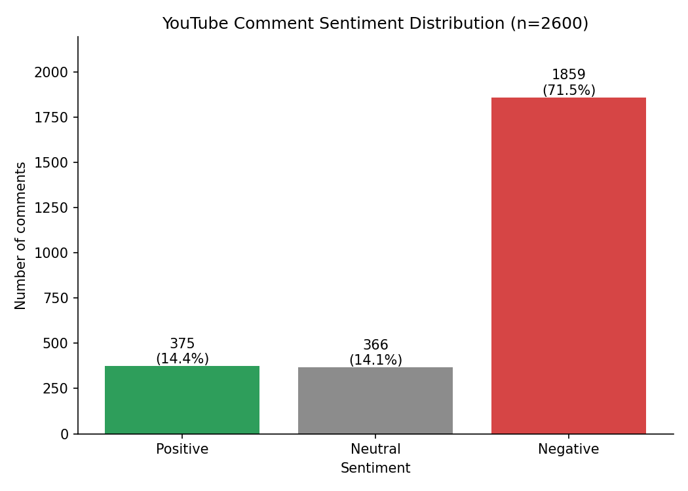
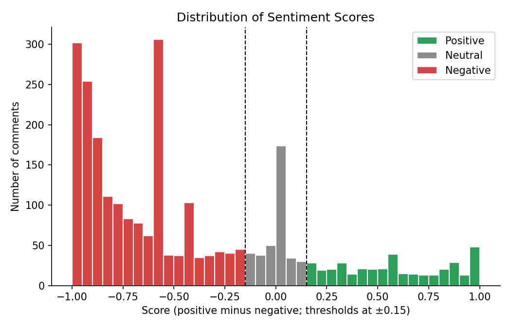
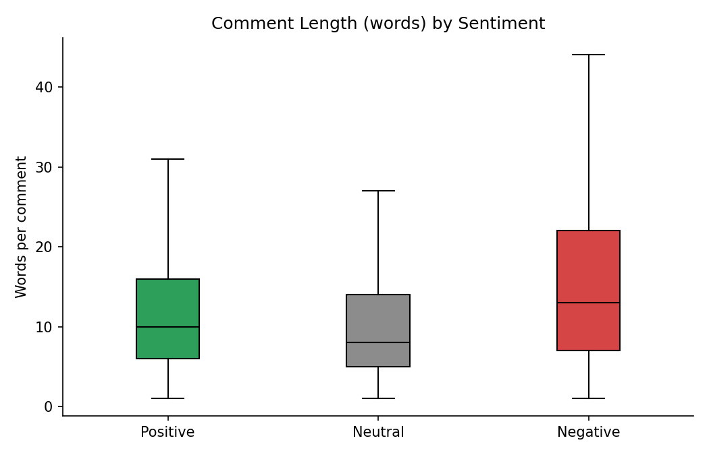
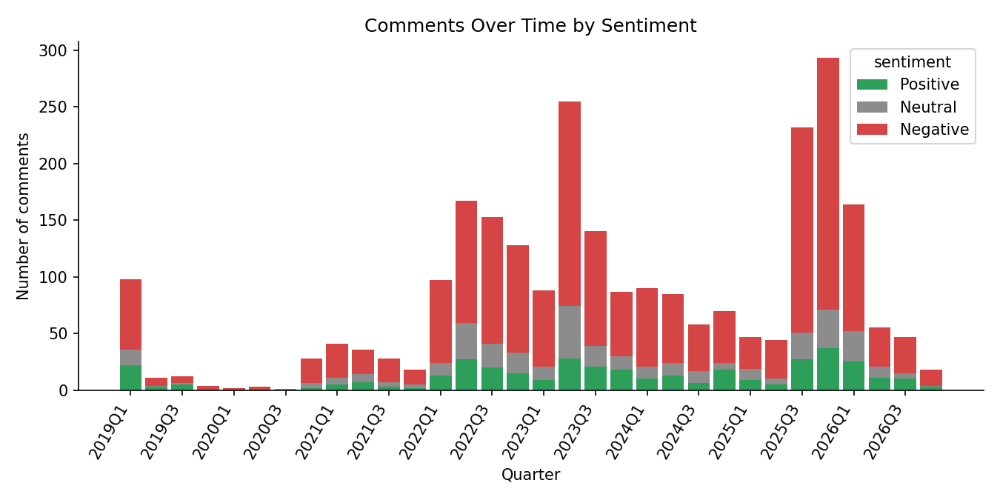
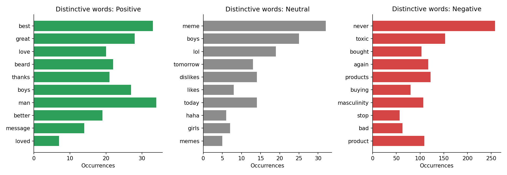

# YouTube Comment Sentiment Analyzer

Collect more than 2,000 comments from a YouTube video, classify each one as **Positive**, **Neutral** or **Negative** (English, Roman Urdu and other languages), run exploratory data analysis (EDA), and export CSV files plus charts.

Collection and analysis are separate steps: comments are fetched once into a CSV, and sentiment analysis runs later on command, so the API quota is spent only once.

## What it does

1. `fetch.py` collects top-level comments through the YouTube Data API v3 (one or more videos) into `output/raw_comments.csv`.
2. `main.py` cleans the text (HTML entities, URLs, @mentions, whitespace), removes empty, duplicate and spam comments, and classifies every comment.
3. Classification uses a multilingual transformer model combined with a Roman Urdu / English lexicon and stance rules (see below). VADER and an LLM engine are available as alternatives.
4. Results are saved to `output/classified_comments.csv` with a distribution chart.
5. `eda.py` (called automatically by `main.py`) saves summary tables and charts.

## Setup

```bash
python -m venv .venv
.venv\Scripts\activate        # Windows
# source .venv/bin/activate   # macOS / Linux
pip install -r requirements.txt
```

Create a YouTube Data API v3 key in Google Cloud Console, then create a `.env` file in the project root:

```
YOUTUBE_API_KEY=your_key_here
ANTHROPIC_API_KEY=your_key_here   # only needed for --engine claude
```

## Run

**Step 1: fetch comments**

```bash
python fetch.py --videos https://www.youtube.com/watch?v=VIDEO_ID --max-comments 2500
```

**Step 2: analyze sentiment**

```bash
python main.py
```

Running either script without `--videos` (fetch) prompts for the video URLs instead.

### fetch.py options

| Option | Meaning | Default |
|---|---|---|
| `--videos` | One or more video URLs or IDs | prompt |
| `--max-comments` | Comments to fetch per video and per order | 2500 |
| `--order` | `relevance`, `time` or `both` | both |
| `--output` | CSV file to create or extend | `output/raw_comments.csv` |

### main.py options

| Option | Meaning | Default |
|---|---|---|
| `--input` | Comments CSV created by `fetch.py` | `output/raw_comments.csv` |
| `--engine` | `xlmr` (multilingual model + rules), `vader` (English only) or `claude` (LLM, best for sarcasm) | xlmr |
| `--target` | What the sentiment is about (used by `--engine claude`) | the advertisement and the brand behind it |
| `--llm-model` | Claude model for `--engine claude` | claude-haiku-5-5 |
| `--no-rules` | Disable the stance rules (local engines) | off |
| `--stopwords` | Extra words to hide from the word charts | none |
| `--output-dir` | Where results are written | output |
| `--evaluate` | Labelled review CSV; prints accuracy against `classified_comments.csv` | off |
| `--demo` | Synthetic offline data to test the pipeline (writes to `output_demo/`) | off |
| `--demo-size` | Number of synthetic comments | 2500 |

If fewer than 2,000 unique comments remain after cleaning, the program prints a warning; fetch more comments or add more videos.

## How sentiment is scored

- **xlmr (default):** `cardiffnlp/twitter-xlm-roberta-base-sentiment` gives a base score for each comment.
- **Lexicon:** a weighted (0.35) score from curated English and Roman Urdu positive and negative word lists, negators (nahi, never, not) and emoji polarity is added to the base score.
- **Stance rules:** regular expressions correct patterns general models handle poorly, such as boycott or "stopped buying" statements (negative), "will only buy" statements (positive), timestamps and meme comments (neutral), and laughing emoji that signal sarcasm.
- **Labels:** the final score is clipped to [-1, 1]; a score >= 0.15 is Positive, <= -0.15 is Negative, otherwise Neutral.
- **vader:** VADER compound score plus the same lexicon and rules.
- **claude:** batched, cached LLM labelling of each comment.

## Output files

| File | Description |
|---|---|
| `output/raw_comments.csv` | Fetched comments: comment_id, video_id, comment, author, published_at, like_count, reply_count |
| `output/classified_comments.csv` | comment_id, video_id, comment, clean_comment, author, published_at, like_count, reply_count, sentiment, sentiment_score, confidence |
| `output/spam_comments.csv` | Comments removed by the spam filter |
| `output/review_sample.csv` | Sample for manual labelling (fill `manual_label`, then run `--evaluate`) |
| `output/sentiment_distribution.png` | Bar chart of sentiment counts and percentages |
| `output/eda_summary.txt` | Text summary of the EDA tables, distinctive words and top comments |
| `output/eda_*.csv` | Distribution, per-sentiment statistics, overall descriptive statistics |
| `output/eda_score_histogram.png` | Histogram of sentiment scores |
| `output/eda_length_by_sentiment.png` | Comment length by sentiment |
| `output/eda_sentiment_over_time.png` | Sentiment counts over time |
| `output/eda_top_words.png` | Most frequent words per sentiment |

## Sample results

From one analysed video: 2,631 comments fetched, 2,600 unique comments after cleaning.

| Sentiment | Comments | Share |
|---|---|---|
| Positive | 375 | 14.4% |
| Neutral | 366 | 14.1% |
| Negative | 1,859 | 71.5% |

## Charts

### Sentiment distribution


### Sentiment score histogram


### Comment length by sentiment


### Sentiment over time


### Top words per sentiment


## Validating accuracy

```bash
python main.py --evaluate output/review_sample.csv
```

Fill the `manual_label` column (Positive, Neutral or Negative) first. The command prints accuracy and a confusion matrix.

## Project structure

```text
youtube-comment-sentiment-analyzer/
├── fetch.py                  # YouTube API comment collection
├── main.py                   # cleaning, spam filter, classification, CSV and chart
├── sentiment.py              # xlmr, VADER and Claude engines, lexicon and stance rules
├── eda.py                    # exploratory data analysis
├── demo_data.py              # synthetic data for offline testing
├── tests/
│   ├── test_basic.py
│   └── test_sentiment.py
├── output/                   # results (generated)
├── Project_Documentation.docx
├── requirements.txt
├── .gitignore
└── README.md
```

## Tests

```bash
python -m pytest tests
```

## Limitations

- Sarcasm, slang, mixed opinions and heavily mixed-script comments can still be misclassified.
- Results reflect the collected sample, not every viewer. Relevance ordering favours popular comments.
- Sentiment labels describe tone, not whether a comment is factually correct.

## Responsible use

- Follow YouTube's Terms of Service, API policies and quota limits.
- Do not publish personal information; author names are collected only for dataset completeness.
- Never commit `.env`; it is already in `.gitignore`.